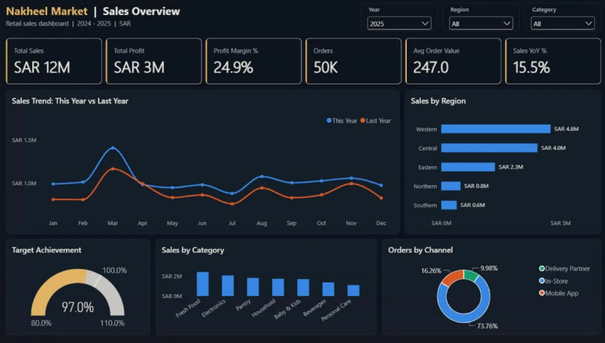
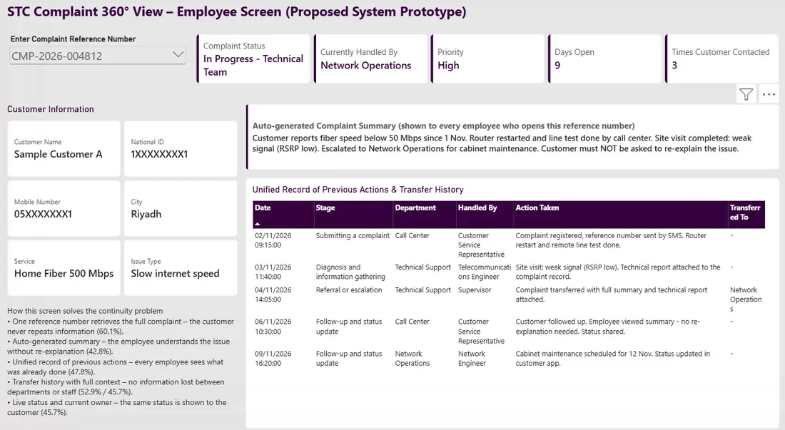
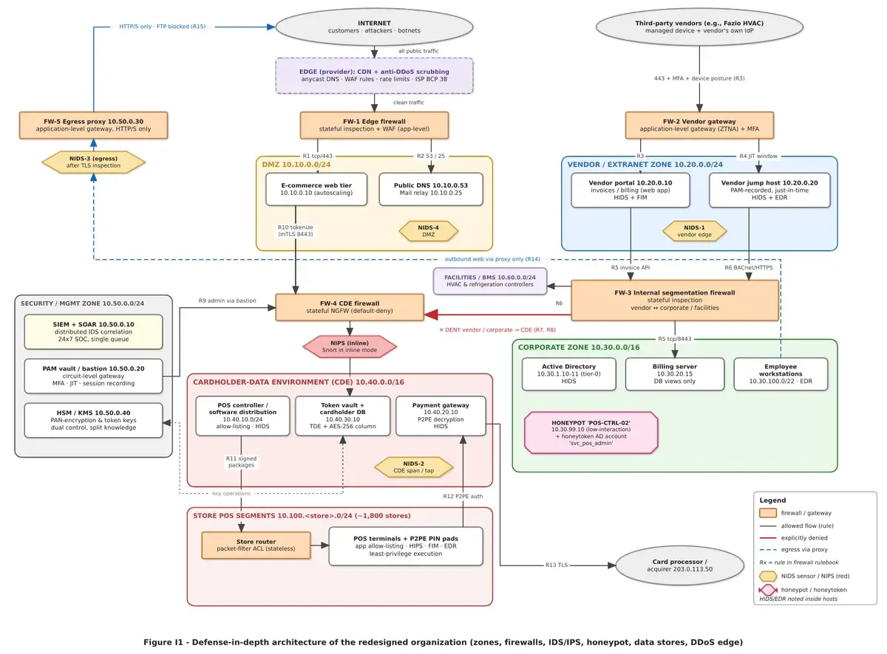

  

  
  
  

### About me

I'm a Management Information Systems student at the University of Tabuk (GPA 4.32 / 5) with a business administration background. I start with the decision someone has to make, then work back to the KPIs, the data model and the dashboard that answer it.

- 📊 Building Power BI reports with clean star-schema models and DAX
- 🏢 Working with **Odoo ERP** and the business processes behind operational data
- 🧭 Using SWOT, PESTEL, VRIO and quantitative models to support decisions
- 🎓 Graduating 2027 · open to co-op training and junior analyst roles

---

### Featured project: Nakheel Market Sales Dashboard

A 3-page Power BI report on a synthetic 12-branch Saudi retail chain: **221K sales lines · 6-table star schema · 37 DAX measures**. Built to answer one question: where are sales growing, and which branches and categories are holding the business back?

  <a href="https://github.com/roaa-alghamdi/nakheel-retail-sales-dashboard"><b>View the repository →</b></a> &nbsp;·&nbsp;
  <a href="https://roaa-alghamdi.github.io/dashboard/"><b>Open the interactive version →</b></a>

---

### More projects

<table>
  <tr>
    <td width="50%" valign="top">
      
      <h4>STC: Customer Context Continuity</h4>
      Graduation project. Survey of 250 customers, 5 stakeholder interviews, 6 continuity KPIs and 3 Power BI dashboards. 73.8% of complainants lost context at least once.  
        
    </td>
    <td width="50%" valign="top">
      
      <h4>Target 2013 Breach: Security Redesign</h4>
      Kill-chain analysis and a defense-in-depth redesign: least-privilege PostgreSQL roles, row-level security and a Python SQL injection demo.  
        
    </td>
  </tr>
  <tr>
    <td width="50%" valign="top">
      <h4><a href="https://github.com/roaa-alghamdi/aramco-financial-ratio-analysis">Saudi Aramco: Ratio Analysis</a></h4>
      Common-size statements and ratio analysis, 2022 vs 2023. Revenue −17.6%, net income −24.7%, net margin 30.1% → 27.5%.  
       
    </td>
    <td width="50%" valign="top">
      <h4><a href="https://github.com/roaa-alghamdi/astra-markets-decision-analysis">ASTRA Markets: Decision Analysis</a></h4>
      Should a grocery chain automate replenishment? Break-even, linear programming, sensitivity analysis and a decision tree in Excel Solver.  
       
    </td>
  </tr>
</table>

---

### Toolkit

  
  
  
  
  
  

| Analysis | Business | Decision support |
|---|---|---|
| Data modelling (star schema) | Process analysis | KPI design |
| DAX measures & time intelligence | Requirements gathering | SWOT · PESTEL · VRIO · 5 Forces |
| Financial ratios & variance analysis | Workflow mapping | LP, sensitivity & decision trees |

### Certifications

| | |
|---|---|
| **AI Data Analytics Certification** · TVTC · 2026 | **Data Fundamentals** · IBM SkillsBuild · 2026 · [verify](https://www.credly.com/badges/d851517f-51d9-4d83-879f-7fc7dadeb54a) |
| **Getting Started with Data** · IBM SkillsBuild | **Data Analysis Using Power BI** |
| **Excel Skills & Data Processing** · TVTC-accredited, 20 h | **AI & Data Analysis in the Future Labour Market** · HRDF & stc |
| **Professional Diploma in Cybersecurity** · Gulf Colleges · 2025 | |
